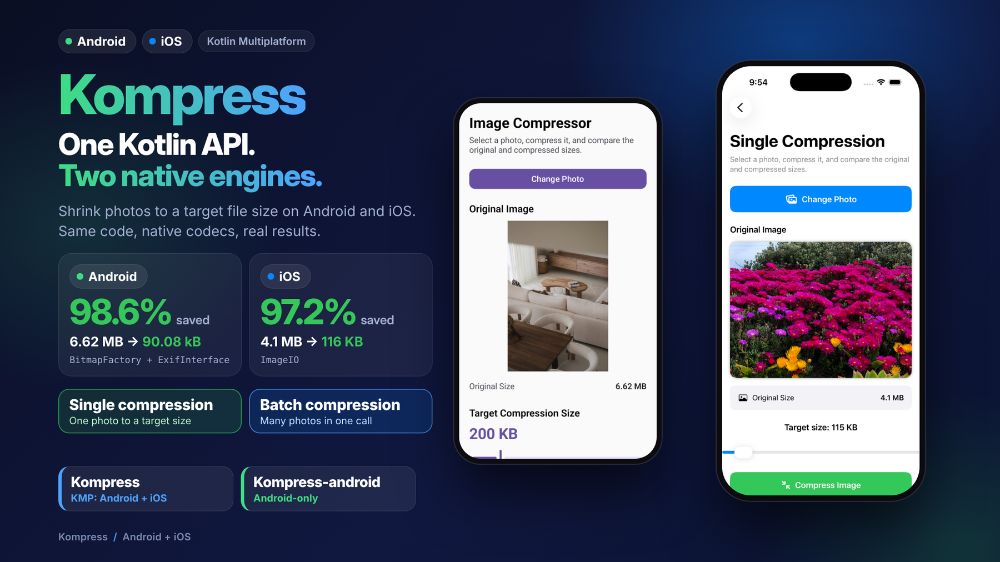
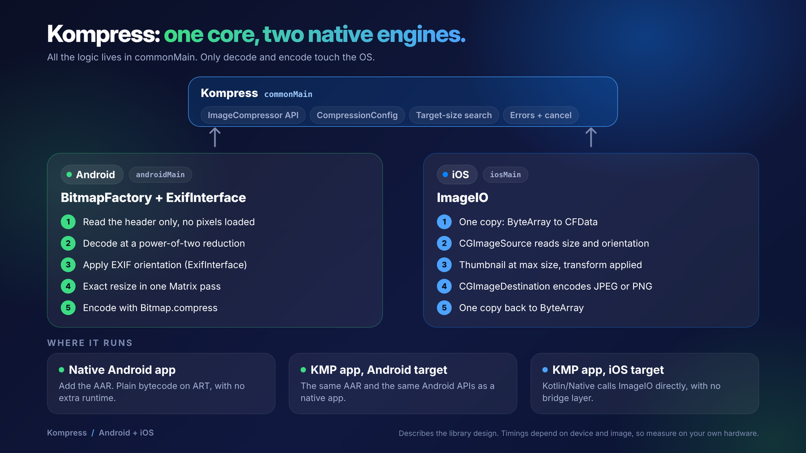
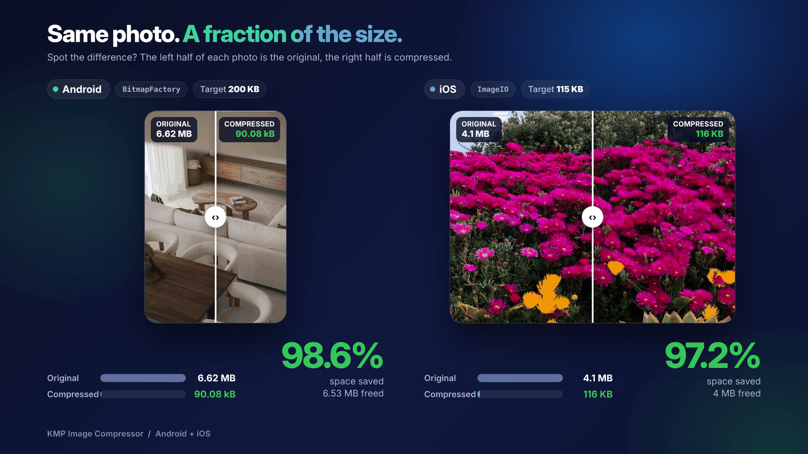
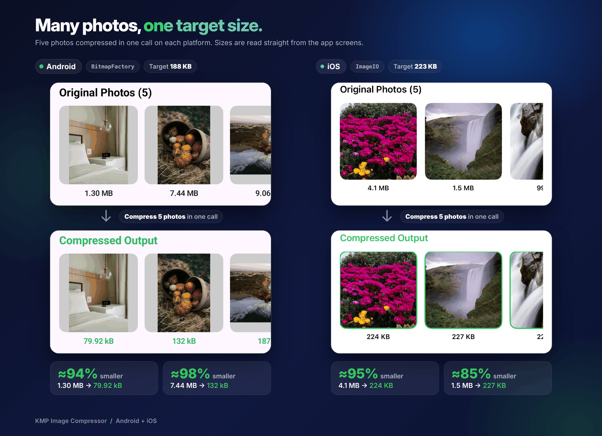

<div align="center">

# Kompress

**Shrink photos to upload-ready size on for KMP(Android, iOS) and for Android-only with one small, coroutine-friendly API.**

Native codecs under the hood. No bundled encoders. Same code, same result, both platforms.

[](https://central.sonatype.com/artifact/io.github.muhammadunderscoreusman/Kompress)
[](https://kotlinlang.org/docs/multiplatform.html)

[](LICENSE)

<div align="center">
 
</div>

</div>

---

## 1. Overview

Kompressor takes the bytes of an image, resizes it, fixes its orientation, re-encodes it, and
hands back smaller bytes. You can ask for a fixed quality, a maximum width and height, or a **target file
size** and the library finds the settings for you.

```kotlin
val result = ImageCompressor().compress(
    bytes = photoBytes,
    config = CompressionConfig {
        maxWidth = 1080
        maxHeight = 1080
        targetSizeBytes = 300 * 1024L
    },
)
```

It is built on top of what each platform already ships (`BitmapFactory` on Android, `ImageIO` on iOS), so there
are no native libraries to bundle and the app size barely changes. All the decision-making (quality search,
scaling fallback, error handling, cancellation) lives in shared Kotlin code, so Android and iOS behave the same.

---

## 2. Supported platforms

<div align="center">
 
</div>


| Platform | Engine used | Targets | Minimum |
|---|---|---|---|
| **Android** | `BitmapFactory`, `ExifInterface`, `Bitmap.compress` | AAR (release variant) | minSdk 24 |
| **iOS** | `ImageIO` (`CGImageSource`, `CGImageDestination`) | `iosArm64`, `iosSimulatorArm64`, `iosX64` | iOS 14+ |

Use it from a Kotlin Multiplatform project (shared `commonMain` code), or from a plain Android app: Android-only
projects add the same dependency and get the Android build automatically.

---

## 3. Demo

https://github.com/user-attachments/assets/7404efd2-ed71-4691-bb8f-989009cd2b12

**Single Compression**:

<div align="center">
 
</div>

**Batch Compression**:

<div align="center">
 
</div>

---

## 4. Why Kompress?

Phone cameras produce large files, and most apps do not need them at full size.

- **Faster uploads.** A multi-megabyte photo on a weak mobile connection is the difference between "sent" and
  "retry". Smaller files upload faster and fail less.
- **Lower cost.** Less bandwidth and less storage on your backend and CDN, for every image, forever.
- **Upload limits.** Servers, chat apps and form fields often cap file size. A target-size option lets you meet
  the cap without guessing a quality number.
- **Less memory pressure.** Big bitmaps are the classic cause of `OutOfMemoryError`. Decoding at the size you
  actually need keeps memory use low.
- **One behaviour everywhere.** Orientation bugs, alpha-to-black bugs and quality drift are easy to get wrong
  twice. Here they are solved once and shared.

---

## 5. What's inside

### Modules

| Module               | Platforms           |
|----------------------|---------------------|
| `kompress`           | Android, iOS (KMP)  |
| `kompress-android` | Android only        |

### Features

- Resize to a maximum width and height, keeping the aspect ratio. Images are **never upscaled**.
- Quality control (0 to 100) for JPEG.
- **Target file size**: lowers quality first, then scales the image down, until the result fits.
- Correct **EXIF orientation**: output is upright on both platforms.
- **Decodes at reduced size**, so a 48 MP photo is never fully loaded when you only need 1080 px.
- Transparent images converted to JPEG are flattened onto white, not black.
- Structured errors instead of crashes: the call returns a `Result` with a typed `CompressionError`.
- Cancellable: works with structured concurrency and stops between stages when its coroutine is cancelled.

### How it works

```
 Your app (Android / iOS / KMP)
            |
            v
 +----------------------------------------------------------+
 |  Kompress  (Kotlin Multiplatform)                         |
 |                                                           |
 |   commonMain   ImageCompressor, CompressionConfig         |
 |                target-size search, errors, cancellation   |
 |                      |                                    |
 |        +-------------+--------------+                     |
 |        v                            v                     |
 |   androidMain                   iosMain                   |
 |   BitmapFactory                 ImageIO                   |
 |   ExifInterface                 CGImageSource             |
 |   Bitmap.compress               CGImageDestination        |
 +----------------------------------------------------------+
```

Each call runs the same pipeline on both platforms:

1. **Decode small and upright**: read the header, work out the final size, decode at a reduced size, apply EXIF orientation.
2. **Encode** at the requested quality.
3. **If a target size is set and the result is too big**: search for the highest quality that fits (about six encodes, no re-decode).
   If even the lowest allowed quality is too big, re-decode at 85% of the size and try again, up to four times.
4. **Return** the bytes together with the final width and height.

---

## 6. Installation

Artifacts are published to **Maven Central**, so make sure it is in your repositories (it is by default in new projects):

```kotlin
// settings.gradle.kts
dependencyResolutionManagement {
    repositories {
        google()
        mavenCentral()
    }
}
```

### Kotlin Multiplatform project

```kotlin
// shared/build.gradle.kts
kotlin {
    sourceSets {
        commonMain.dependencies {
            implementation("io.github.muhammadunderscoreusman:Kompress:1.0.0")
        }
    }
}
```

Gradle picks the Android or iOS variant for each target automatically.

### Android-only project

```kotlin
// app/build.gradle.kts
dependencies {
    implementation("io.github.muhammadunderscoreusman:Kompress-android:1.0.0")
}
```

### Using a version catalog

```toml
# gradle/libs.versions.toml
[versions]
compressor = "1.0.0"

[libraries]
# For KMP Projects
compressor-core = { module = "io.github.muhammadunderscoreusman:Kompress", version.ref = "compressor" }

# or for Android-only (if we are developing only Android App)
compressor-android = { module = "io.github.muhammadunderscoreusman:Kompress-android", version.ref = "compressor" }
```

### iOS

Use the library from your shared Kotlin module and expose your own functions to Swift. The library is a Kotlin API
(`suspend` functions and `Result`), so it is designed to be called from Kotlin code, which then calls your native iOS app.

### Requirements

| | Minimum |
|---|---|
| Android | minSdk 24 |
| iOS | 14.0 |
| Kotlin | 2.0 or newer recommended |

No permissions, no manifest entries and no ProGuard/R8 rules are needed.

---

## 7. Usage

Imports used below:

```kotlin
import io.github.yourname.compressor.CompressedImage
import io.github.yourname.compressor.CompressionConfig
import io.github.yourname.compressor.CompressionError
import io.github.yourname.compressor.ImageCompressor
import io.github.yourname.compressor.OutputFormat
import io.github.yourname.compressor.compress
```

### 7.1 The simplest call

Create one compressor and reuse it. It holds no state and is safe to share.

```kotlin
val compressor = ImageCompressor()

val result: Result<CompressedImage> = compressor.compress(photoBytes)

result.onSuccess { image ->
    println("${image.width} x ${image.height}, ${image.sizeBytes} bytes")
    upload(image.bytes)
}
```

With no config you get JPEG at quality 80, no resizing.

### 7.2 Resize and set quality

Fit the image inside a box. The aspect ratio is kept and small images are never enlarged.

```kotlin
val config = CompressionConfig {
    maxWidth = 1080
    maxHeight = 1080
    quality = 85          // 0..100, JPEG only
}

val image = compressor.compress(photoBytes, config).getOrThrow()
```

You can set just one side. For example, `maxWidth = 1080` alone limits the width and the height follows.

### 7.3 Hit a target file size

Instead of guessing a quality, say how big the file may be. The library lowers quality down to `minQuality`,
and if that is not enough it scales the image down in small steps.

```kotlin
val config = CompressionConfig {
    maxWidth = 1600
    quality = 90                      // start here, the highest quality you accept
    minQuality = 50                   // never go below this before scaling down
    targetSizeBytes = 500 * 1024L     // 500 KB
}

val image = compressor.compress(photoBytes, config).getOrThrow()
check(image.sizeBytes <= 500 * 1024)
```

### 7.4 Handle errors properly

Failures come back as values, so a corrupt file never crashes your app. Only coroutine cancellation is rethrown.

```kotlin
compressor.compress(photoBytes, config).fold(
    onSuccess = { image -> upload(image.bytes) },
    onFailure = { error ->
        when (error) {
            is CompressionError.InvalidImage ->
                showMessage("That file is not a valid image.")

            is CompressionError.TargetSizeNotReachable ->
                // Even the smallest result (error.bestSizeBytes) was above the target.
                showMessage("Could not get under ${error.targetSizeBytes} bytes. Closest: ${error.bestSizeBytes}")

            is CompressionError.OutOfMemory ->
                showMessage("Not enough memory for this image.")

            is CompressionError.EncodingFailed,
            is CompressionError.Unknown -> log(error)

            else -> log(error)
        }
    },
)
```

Fall back to a smaller size when the target cannot be reached:

```kotlin
val first = compressor.compress(photoBytes, CompressionConfig { targetSizeBytes = 100 * 1024L })

val image = first.getOrElse { error ->
    if (error is CompressionError.TargetSizeNotReachable) {
        compressor.compress(photoBytes, CompressionConfig { maxWidth = 600; targetSizeBytes = 100 * 1024L }).getOrThrow()
    } else throw error
}
```

### 7.5 PNG output

PNG is lossless, so `quality` is ignored. With a target size, PNG is reduced by scaling down only.

```kotlin
val config = CompressionConfig {
    format = OutputFormat.Png
    maxWidth = 512
}
```

Use PNG when you need to keep transparency (logos, stickers). Transparent images saved as JPEG are flattened onto white.

### 7.6 Compress a photo picked on Android

Read the bytes off the main thread, compress, and show the result. The library runs the heavy work on a background
dispatcher itself.

```kotlin
class PhotoViewModel(private val compressor: ImageCompressor = ImageCompressor()) : ViewModel() {

    fun onPhotoPicked(context: Context, uri: Uri) = viewModelScope.launch {
        val original = withContext(Dispatchers.IO) {
            context.contentResolver.openInputStream(uri)?.use { it.readBytes() }
        } ?: return@launch

        compressor.compress(
            bytes = original,
            config = CompressionConfig { maxWidth = 1080; maxHeight = 1080; targetSizeBytes = 300 * 1024L },
        ).onSuccess { image ->
            val saved = 100 - image.sizeBytes * 100L / original.size
            Log.d("Photo", "${original.size / 1024} KB -> ${image.sizeBytes / 1024} KB (saved $saved%)")
            // show or upload image.bytes
        }
    }
}
```

If you use the `compressor-android` module, it adds helpers for `Uri`, `File` and `Bitmap` so you can skip the manual
byte reading. See its README for the exact functions.

### 7.7 Shared code for both platforms

Write the logic once in `commonMain`. Each app only has to give it the image bytes.

```kotlin
class PhotoUploader(
    private val api: UploadApi,
    private val compressor: ImageCompressor = ImageCompressor(),
) {
    private val config = CompressionConfig {
        maxWidth = 1280
        maxHeight = 1280
        targetSizeBytes = 400 * 1024L
    }

    suspend fun upload(photo: ByteArray): Result<Unit> {
        val image = compressor.compress(photo, config).getOrElse { return Result.failure(it) }
        return runCatching { api.upload(image.bytes, image.width, image.height) }
    }
}
```

On Android, the bytes come from a `Uri`. On iOS, they come from the photo picker data. The compression code is identical.

### 7.8 Compress many images at once

Compress several photos with a small concurrency limit. Decoding many large images at the same time is the fastest way
to run out of memory, so keep the limit low (2 or 3).

```kotlin
suspend fun compressAll(
    photos: List<ByteArray>,
    config: CompressionConfig,
    maxParallel: Int = 2,
): List<Result<CompressedImage>> = coroutineScope {
    val gate = Semaphore(maxParallel)
    photos.map { bytes ->
        async { gate.withPermit { compressor.compress(bytes, config) } }
    }.awaitAll()
}
```

You get one `Result` per photo, in the same order as the input, so one bad file does not fail the batch.

### 7.9 Cancellation

Compression follows structured concurrency. Cancel the coroutine (leave the screen, cancel the job) and the work stops
between stages, even in the middle of the target-size search.

```kotlin
val job = scope.launch {
    compressor.compress(photoBytes, config).onSuccess { upload(it.bytes) }
}

cancelButton.setOnClickListener { job.cancel() }
```

### Good to know

- **Orientation is applied for you.** A portrait photo stored sideways with an EXIF tag comes out upright.
- **Metadata is removed.** Location and camera data are not copied into the output.
- **Never upscaled.** `maxWidth` and `maxHeight` are upper limits, not target sizes.
- **Results can differ slightly between platforms.** The native encoders are not identical, so byte sizes can vary a little
  and dimensions can differ by a pixel. The shared logic makes both platforms behave alike, but they are not byte-for-byte equal.

---

## 8. Catalog

### Public API

| Type | Purpose |
|---|---|
| `ImageCompressor()` | Creates a compressor backed by the platform's native codecs. Stateless and thread-safe |
| `ImageCompressor.compress(bytes, config)` | Compresses image bytes and returns `Result<CompressedImage>` |
| `ImageCompressor.compress(source, config)` | Same, taking an `ImageSource` (`ImageSource.Bytes` today) |
| `CompressionConfig { ... }` | Builds the settings with a DSL. Invalid values throw `IllegalArgumentException` immediately |
| `CompressedImage` | Result: `bytes`, `width`, `height`, `format`, `sizeBytes` |
| `OutputFormat` | `Jpeg` (lossy) or `Png` (lossless) |
| `CompressionError` | Sealed error type, see below |

### Configuration options

| Option | Type | Default | Description |
|---|---|---|---|
| `maxWidth` | `Int?` | `null` | Maximum output width in pixels (after orientation). `null` means no limit |
| `maxHeight` | `Int?` | `null` | Maximum output height in pixels (after orientation). `null` means no limit |
| `quality` | `Int` | `80` | Encoder quality from 0 to 100. Ignored for PNG. With a target size, this is the highest quality tried |
| `format` | `OutputFormat` | `Jpeg` | Output format |
| `targetSizeBytes` | `Long?` | `null` | If set, the library lowers quality, then scales down, until the output fits |
| `minQuality` | `Int` | `40` | Lowest quality the target-size search may use. Capped to `quality` |

### Errors

| Error | When it happens |
|---|---|
| `InvalidImage` | The bytes are empty, corrupt, or not an image the platform can decode |
| `OutOfMemory` | The device could not allocate enough memory for this image |
| `EncodingFailed` | The platform encoder reported a failure |
| `TargetSizeNotReachable` | Still above the target after the lowest quality and maximum scale-down. Carries `bestSizeBytes` and `targetSizeBytes` |
| `Unknown` | Anything unexpected, with the original exception as `cause` |

### Behaviour by platform

| | Android | iOS |
|---|---|---|
| Decode | `BitmapFactory` with `inSampleSize` (power-of-two reduction), then exact resize | `ImageIO` thumbnail API, decodes directly at the reduced size |
| Orientation | `ExifInterface` + matrix transform | Applied by `ImageIO` during decode |
| Transparent to JPEG | Drawn on white | Drawn on white |
| Output formats | JPEG, PNG | JPEG, PNG |
| Metadata in output | Stripped | Stripped |
| Threading | `Dispatchers.Default`, cancellable | `Dispatchers.Default`, cancellable |

### Not supported yet

- WebP and HEIC output
- Keeping metadata (EXIF/GPS) as an option
- File and URI sources in the core module (use the Android module, or read the bytes yourself)

---

_Disclaimer: Image used in this Project for Demo purpose belongs to https://unsplash.com/._

---

## License

```
Copyright 2026 muhammadunderscoreusman(Muhammad Usman)

Licensed under the Apache License, Version 2.0 (the "License");
you may not use this file except in compliance with the License.
You may obtain a copy of the License at

    http://www.apache.org/licenses/LICENSE-2.0

Unless required by applicable law or agreed to in writing, software
distributed under the License is distributed on an "AS IS" BASIS,
WITHOUT WARRANTIES OR CONDITIONS OF ANY KIND, either express or implied.
See the License for the specific language governing permissions and
limitations under the License.
```
---


This is a Kotlin Multiplatform project targeting Android, iOS.

* [/iosApp](./iosApp/iosApp) contains an iOS application. Even if you’re sharing your UI with Compose Multiplatform,
  you need this entry point for your iOS app. This is also where you should add SwiftUI code for your project.

* [/sharedLogic](./sharedLogic/src) is for the code that will be shared between app targets in the project.
  The most important subfolder is [commonMain](./sharedLogic/src/commonMain/kotlin). If preferred, you
  can add code to the platform-specific folders here too.

* [/sharedUI](./sharedUI/src) is for code that will be shared across your Compose Multiplatform applications.
  It contains several subfolders:
  - [commonMain](./sharedUI/src/commonMain/kotlin) is for code that’s common for all targets.
  - Other folders are for Kotlin code that will be compiled for only the platform indicated in the folder name.
    For example, if you want to use Apple’s CoreCrypto for the iOS part of your Kotlin app,
    the [iosMain](./sharedUI/src/iosMain/kotlin) folder would be the right place for such calls.
    Similarly, if you want to edit the Desktop (JVM) specific part, the [jvmMain](./sharedUI/src/jvmMain/kotlin)
    folder is the appropriate location.

### Running the apps

Use the run configurations provided by the run widget in your IDE's toolbar. You can also use these commands and options:

- Android app: `./gradlew :androidApp:assembleDebug`
- iOS app: open the [/iosApp](./iosApp) directory in Xcode and run it from there.

---

Learn more about [Kotlin Multiplatform](https://www.jetbrains.com/help/kotlin-multiplatform-dev/get-started.html)…

